# NineCube.Digital — System user manual

Everything in this manual was photographed from the running application. Each screen is a real
browser at a real URL, talking to the real API and the real database, with the numbered marks drawn
over the actual controls — not over a mock-up and not over a description of one. The wording behind
every number is kept in machine-readable form in `docs/manual/callouts.json`, and the pictures can be
regenerated at any time with `web/scripts/capture-manual.mjs`.

Who it is for:

| You are | Read |
| --- | --- |
| A customer buying equipment | Part 2 |
| A sales manager working orders and reporting | Part 3 |
| An inventory manager owning products and stock | Part 4 |
| An administrator owning accounts and settings | Part 5 |
| Evaluating or maintaining the system | Part 6 and Part 7 |

---

## Part 1 — Getting in

### 1.1 Start the system

Two processes and a database:

```bash
docker compose up -d                                   # SQL Server on 1433
cd src/NineCube.Api && ASPNETCORE_ENVIRONMENT=Development dotnet run --urls http://localhost:5080
cd web && npm run assets && npm run dev                # SPA on http://127.0.0.1:5173
```

The API answers `GET /health` with `200` when it is ready. The SPA is the only address you type;
it calls the API itself.

### 1.2 Accounts

The seed creates four accounts when `ASPNETCORE_ENVIRONMENT=Development`. The password for all four
comes from `NINECUBE_SEED_PASSWORD` in the environment — it is never stored in the repository, and
this manual never prints it.

| Role | Email | Can do |
| --- | --- | --- |
| Customer | `customer@ninecube.demo` | browse, buy, track their own orders |
| Sales Manager | `staff@ninecube.demo` | catalogue, category management, order lifecycle, sales reporting |
| Inventory Manager | `inventory@ninecube.demo` | products, images, bulk edits, stock adjustments, ledger |
| Administrator | `admin@ninecube.demo` | accounts and roles, audit log, the low-stock threshold; read-only on orders |

### 1.3 Routes

| Route | Page | Needs |
| --- | --- | --- |
| `/` | public showcase | nothing |
| `/login`, `/register` | sign in, create account | nothing |
| `/products`, `/products/:id` | catalogue and product detail | login |
| `/orders`, `/orders/:id`, `/orders/:id/invoice` | order history, one order, printable invoice | login |
| `/account`, `/account/profile`, `/notifications` | dashboard, profile, inbox | login |
| `/staff`, `/staff/sales` | order console, and the category manager beside it; sales report | Sales Manager or Administrator |
| `/inventory` | products and stock | Inventory Manager or Administrator |
| `/admin` | users, audit log, settings | Administrator |

### 1.4 Screen — the public showcase

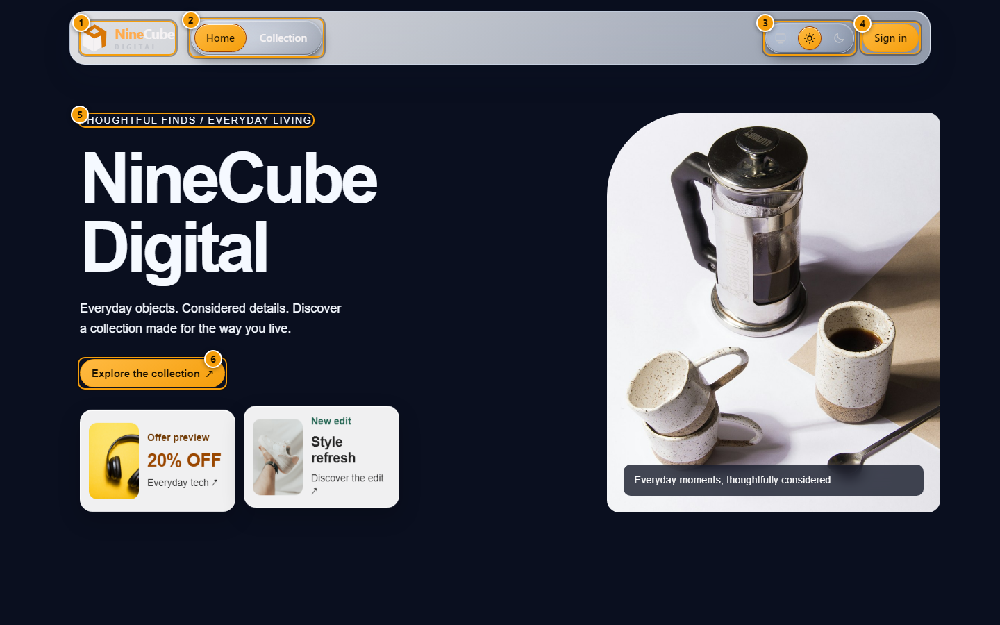

The only screen a visitor sees before signing in. It calls no API, so no stock, price or customer
data appears here.

1. The brand mark. It links to the catalogue once you are signed in, and to this page while you are not
2. The navigation tray. While signed out it holds Home and Collection only
3. Theme control: System follows your device, Light and Dark are remembered between visits
4. Sign in opens the login page
5. The opening line of the showcase
6. Explore the collection goes straight to the catalogue, where you still have to sign in

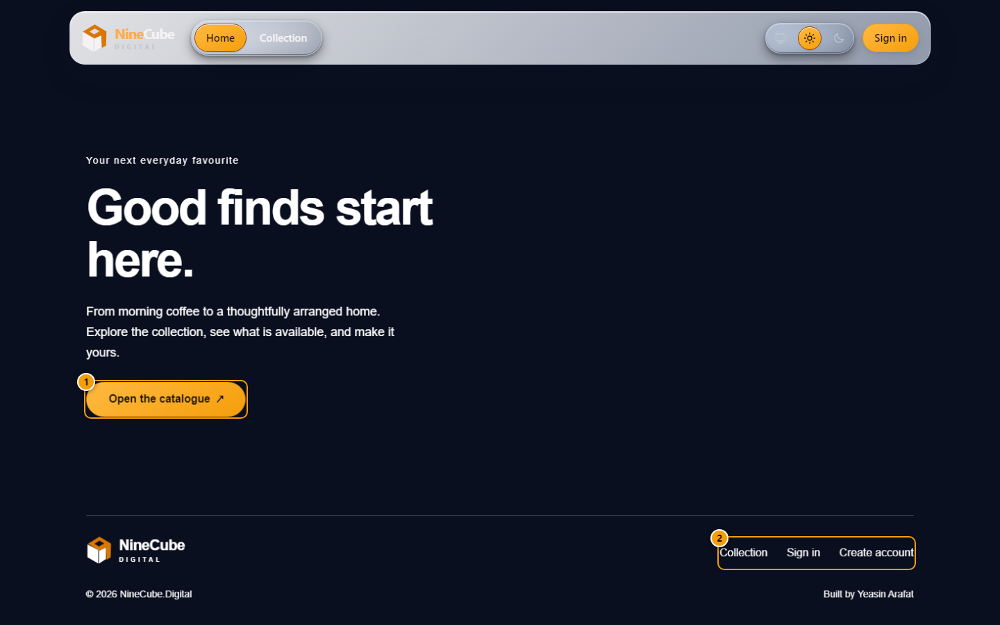

The scroll scene ends on a closing panel and a footer, so the way into the shop is never more than a
scroll away.

1. Open the catalogue is the main route into the shop
2. Sign in and Create account are repeated here so a reader who scrolled past the header is not stuck

If the browser has no WebGL, or you have asked your operating system for reduced motion, the animated
grid is replaced by a static nine-card grid of the same photographs. Nothing about the way in changes.

### 1.5 Screen — signing in

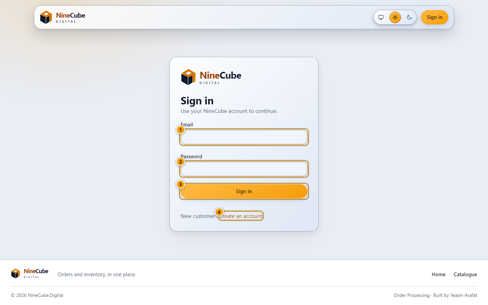

Every screen except the showcase needs an account, because live stock is treated as commercial
information.

1. Your email address, exactly as it was registered
2. Your password. It is never shown in the address bar or stored in the browser beyond the session
3. Sign in. The button reads "Signing in…" while the request is in flight and cannot be pressed twice
4. New customer? Create an account

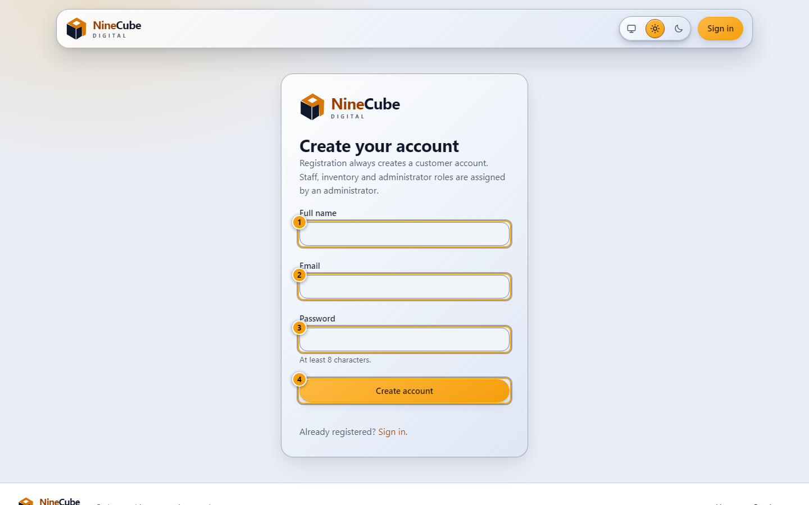

Self-registration always creates a Customer. Staff, Inventory and Administrator logins are made by an
Administrator on the Administration screen.

1. Your full name, as it will appear on orders and invoices
2. Email address, which is also your login
3. A password of at least 8 characters
4. Create account

A signed-in visitor who returns to `/login` is sent straight to the catalogue; a customer who types a
staff URL is sent back with an explanation rather than a blank page.

---

## Part 2 — A customer

### 2.1 Browse the catalogue

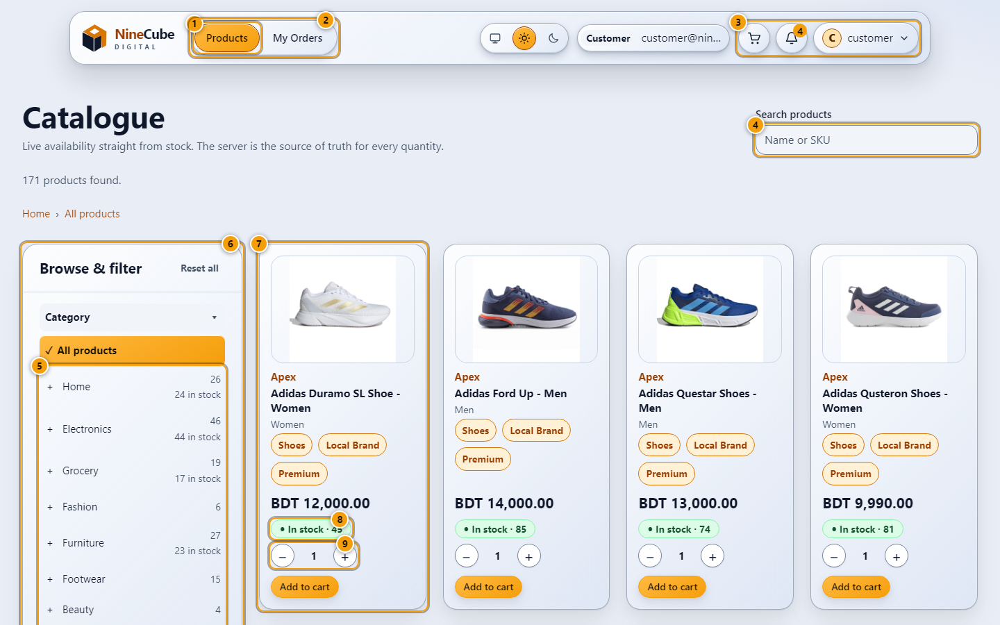

The working screen for a customer: live availability straight from stock, with the server as the source
of truth for every quantity.

1. The tab you are on is filled with the amber selection colour, the same look the open account menu and
   the switched-on theme take
2. Your role's tabs. A customer sees Products and My Orders
3. Cart, notification bell and account menu live in this group
4. Search by product name or SKU. It waits 300 ms after you stop typing
5. The category tree with product counts. Clicking a branch filters the grid
6. Availability, price range and sort live in the same panel
7. A product card. The chips under the name are shortcuts that apply that filter
8. The stock badge: In stock, Low stock with the count left, Out of stock or Inactive. It carries a
   glyph and a word, never colour alone
9. The quantity stepper cannot be raised above what is in stock

To narrow the list:

1. Type in the search box, or click a branch of the category tree.
2. Set a price range with the slider or the two number fields — they keep each other in step, and a
   range where the minimum is above the maximum is not sent.
3. Tick "In-stock only", pick brands or series, add tags. Everything you chose is written into the
   address bar, so the view can be bookmarked, reloaded, or handed to a colleague, and Back returns to
   it exactly as it was.
4. Use the chips on a card to add that category, brand or tag without losing the filters already applied.
5. Reset clears the whole panel in one action.

Prices are in the store currency, Bangladeshi taka (৳), formatted the same way everywhere in the app.

### 2.2 Buy something

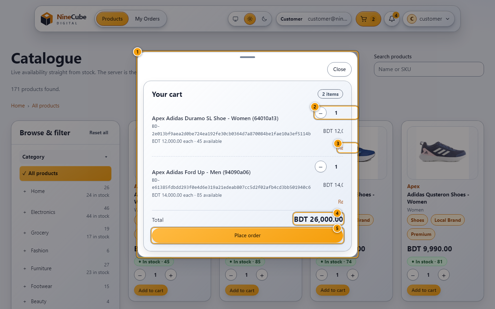

The cart lives in your browser until you place the order. Stock is only reserved at that moment, which
is the first point where the promise can actually be kept.

1. Each line shows the unit price and what is available right now
2. The stepper per line, capped at live stock
3. Remove takes just that line out
4. Total, priced in the store currency
5. Place order sends the whole basket as one request with an idempotency key

What happens when you press Place order:

- The request carries an idempotency key, so a double click, a slow network, or a retry after a
  timeout cannot create two orders.
- If any line is short by the time the server gets there, the whole order is refused, nothing is
  charged to stock, and the cart is left exactly as it was with the offending items named.
- If the network fails, the message is shown twice — once in the page and once as a toast — and the
  cart is kept so nothing you typed is lost.
- If your session has expired you are sent to sign-in, and the retry uses a fresh key rather than
  replaying the failed one.

### 2.3 Follow an order

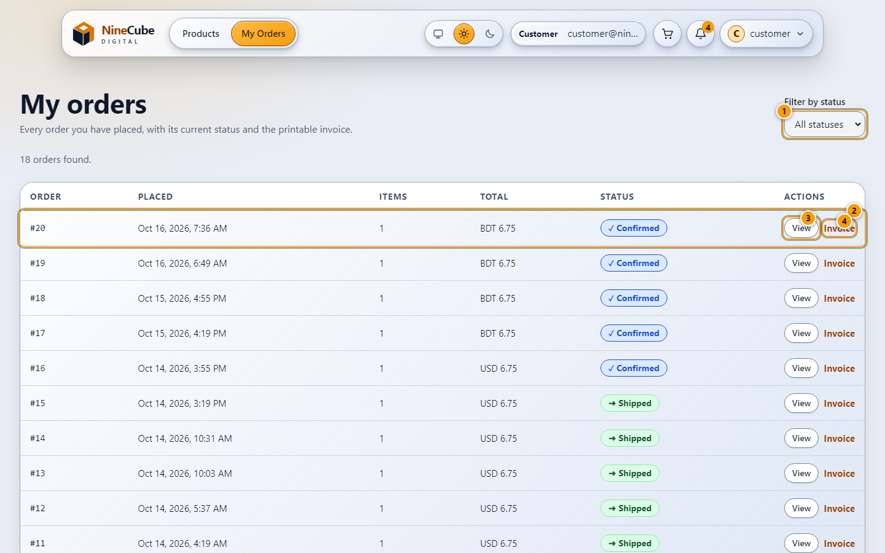

Every order on the account with its current status, and the printable invoice for each.

1. Filter by status. The list is paged at ten orders
2. A row: order number, when it was placed, how many items, the total and where it is now
3. View opens the order with its timeline
4. Invoice opens the printable version

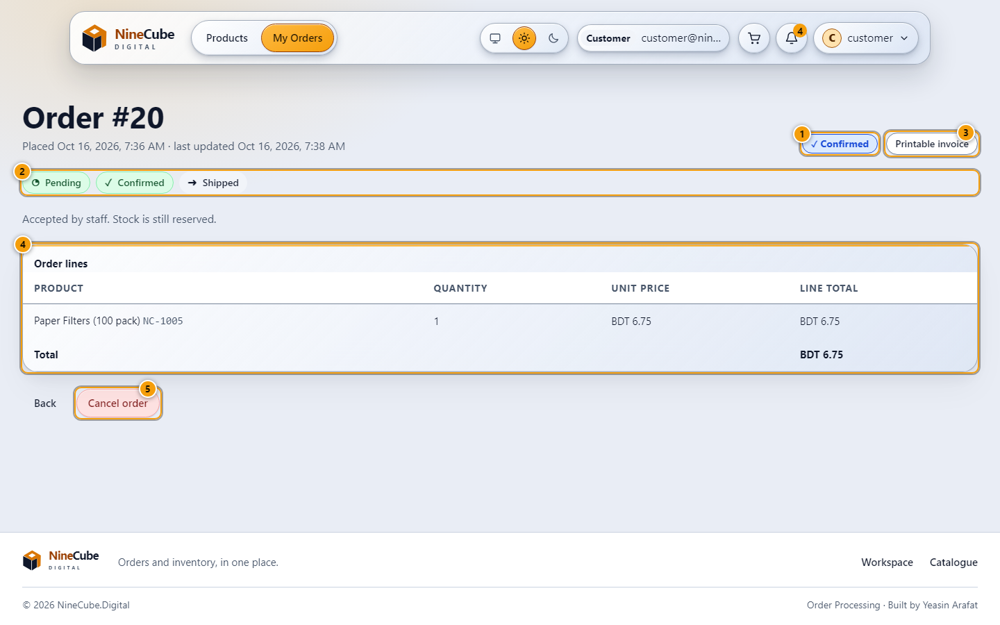

The timeline says exactly where the order is, and the sentence under it says what that status means
for you.

1. The current status
2. Pending, Confirmed, Shipped, or the terminal Rejected or Cancelled
3. Printable invoice
4. The lines as they were bought, with the price the server charged at that moment
5. Cancel order releases the reserved stock. It is offered only while the order is Pending or Confirmed

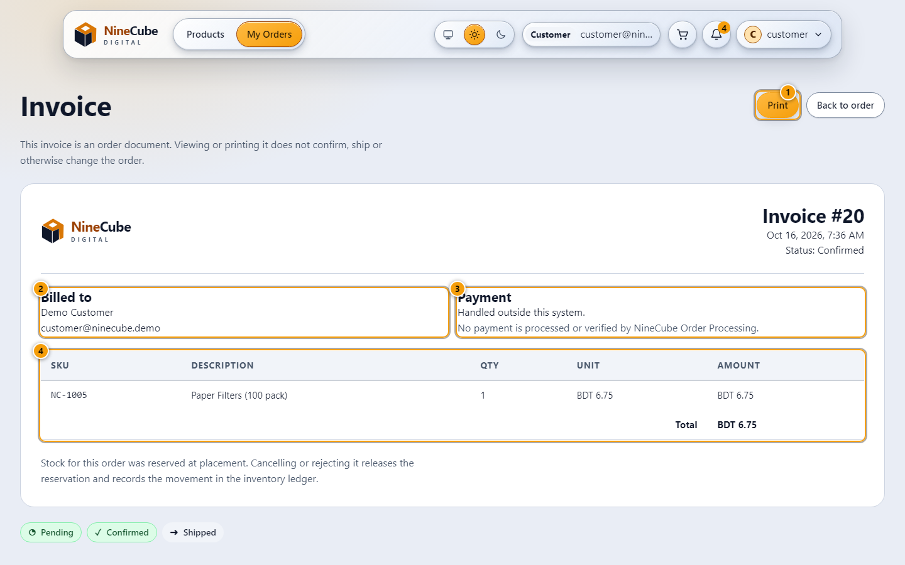

A single page you can print or save as PDF. Printing always uses white paper, whatever theme you read
it in.

1. Print calls the browser's own print dialog
2. Billed to
3. Payment is handled outside this system, and the invoice says so rather than implying it was taken
4. Line items with quantity, unit price and amount

Cancelling is honest about stock: the units go back on the shelf exactly once, even if the button is
pressed twice or two devices cancel the same order at the same moment. After Shipped there is no
cancel button, because at that point the goods have left.

### 2.4 Your account

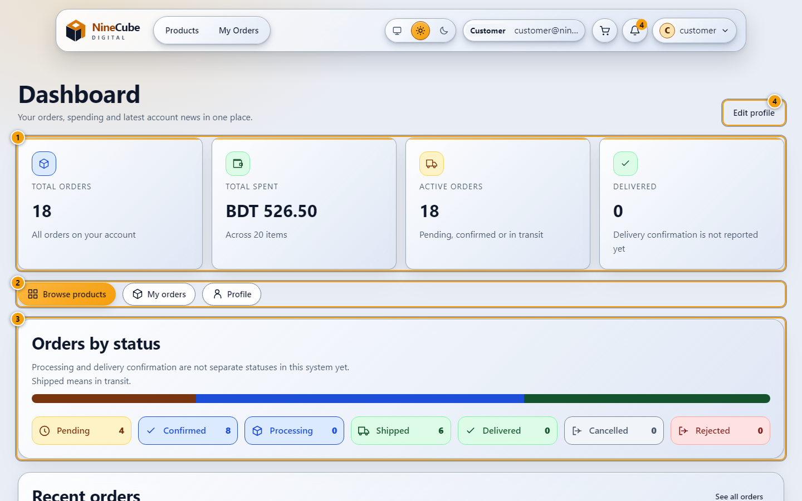

The account summary: what you have ordered, what it cost, and what needs your attention.

1. Total orders, total spent, active orders and delivered, counted from your own orders
2. Shortcuts to the three pages a customer uses
3. Orders by status. Shipped means in transit here; delivery confirmation is a separate status this
   system does not have
4. Edit profile

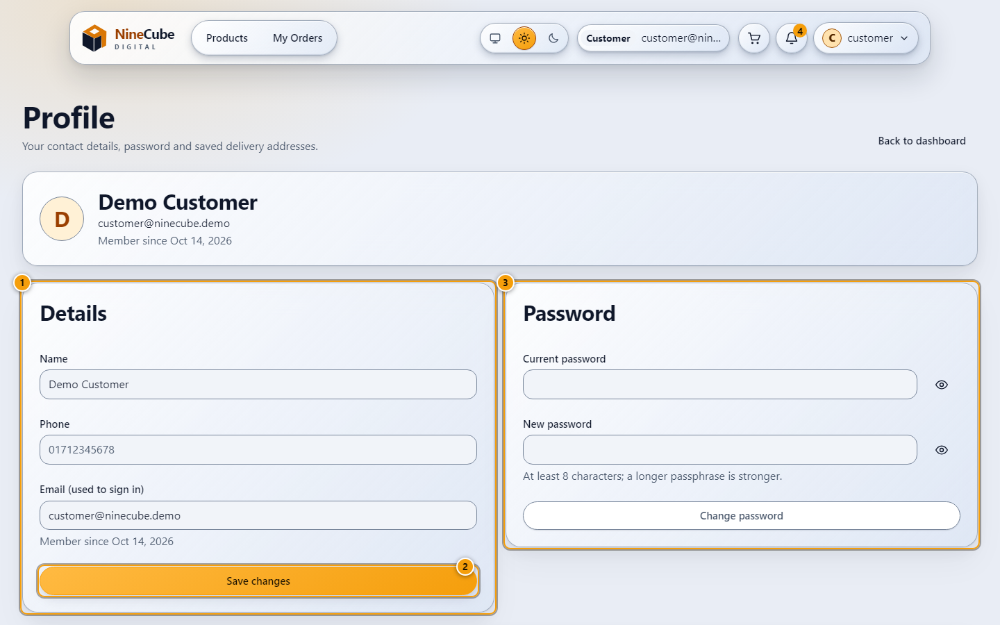

Your contact details, the password you sign in with, and the delivery addresses checkout offers.

1. Name and phone. Your email is the login, so it is shown but not editable
2. Save changes
3. Change password asks for the current one first, and rates the strength of the new one

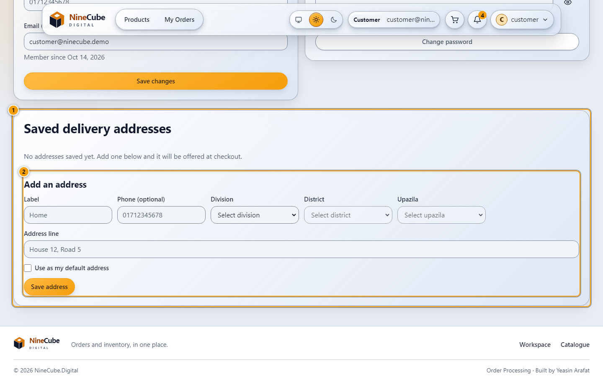

The address book checkout offers, on the same profile page below the password card.

1. Saved delivery addresses. The default one is offered at checkout
2. The form below the list adds an address; Save address keeps it for the next order

An address that is missing a line cannot leave the browser: the fields that need filling are named
one by one. Exactly one address is the default, and choosing another moves the flag rather than
leaving two.

---

## Part 3 — A sales manager

### 3.1 Work the order queues

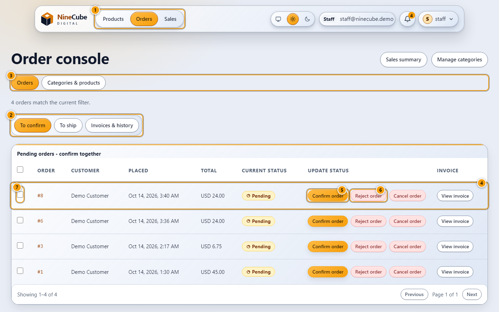

Staff move orders through the lifecycle. They cannot create products or touch stock — that is the
Inventory Manager's job.

1. A staff member's tabs: Products, Orders, Sales
2. The three queues a staff member works through: To confirm, To ship, and Invoices & history
3. Switch between the order list and category management
4. The queue you are in: every order still Pending, oldest first
5. Confirm accepts the order and keeps the stock reserved
6. Reject declines it and releases the reserved stock back to the shelf
7. Tick rows to confirm or reject a batch at once

The order of work:

1. Open Orders. The To confirm queue is the first thing you see, oldest order first, so nothing waits
   behind a newer one.
2. Confirm an order you accept. Stock stays reserved. The customer is notified, and every staff account
   gets a new-order notice.
3. Reject an order you cannot fulfil. The reserved units go back on the shelf, and the customer is
   notified of the change. The mirror-image rule matters more: an order that the server refuses for
   want of stock is rolled back completely, and the notification that would have announced it is part
   of the same transaction, so nothing is left in anybody's inbox.
4. Move to To ship and mark accepted orders Shipped. A Pending order cannot be shipped — confirmation
   has to come first, and the button is not offered.
5. Invoices & history is read-only: every order in every state, with its invoice.

For a batch, tick the rows (or the header tick for the whole page), choose Confirm selected or Reject
selected, and review the dialog that lists what is about to change. A batch request reports the orders
that refused to move — because somebody else shipped them, for instance — without failing the rest,
and closing the review sends nothing at all.

Shipped is not delivered. This system has no delivery-confirmation status, and the reporting keeps the
two apart rather than inflating the completed figure.

### 3.2 Read the sales report

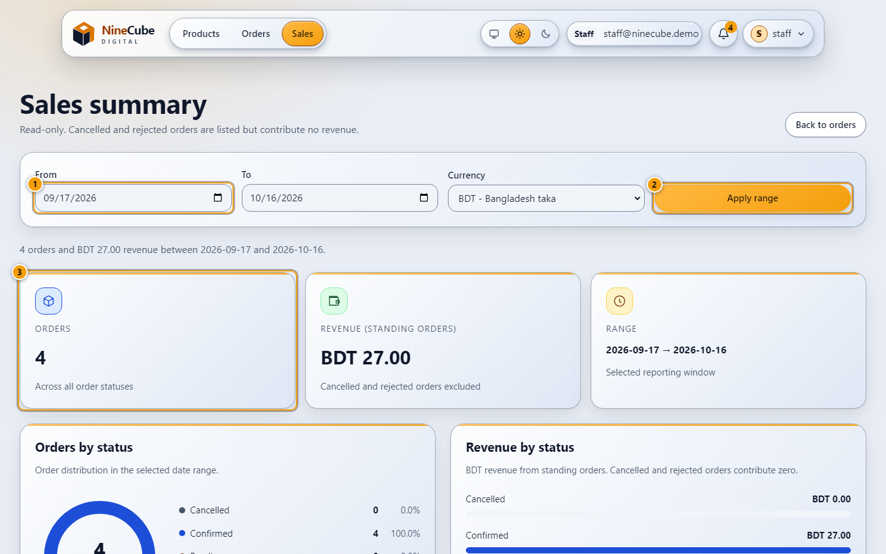

Read-only reporting over every order. Cancelled and rejected orders are counted but bring in no revenue.

1. From and To are calendar days in your own time zone, converted to UTC at the edges
2. Apply range
3. Orders, revenue and the range you asked for

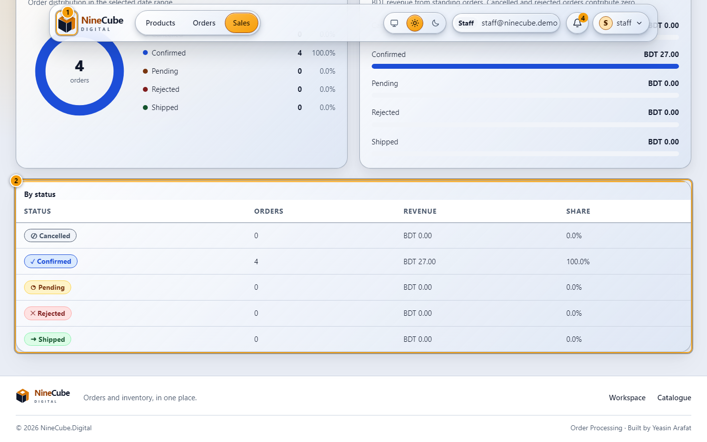

Below the tiles on the sales page: the charts, and the table behind them with each status's share.

1. Orders and revenue by status, drawn as charts
2. The same numbers as a table, so the report is readable without the chart

The range defaults to the last thirty days ending today. An empty range prints an honest empty state;
no bars are invented to fill it. Cancelled and rejected orders appear in the order count with zero
revenue, because they were real orders that brought in nothing.

### 3.3 Manage the category tree

The staff screen has a second half. `Categories & products` replaces the order list with the category
manager: the tree with the stock sitting under each branch, and the editor that files products under
categories and tags.

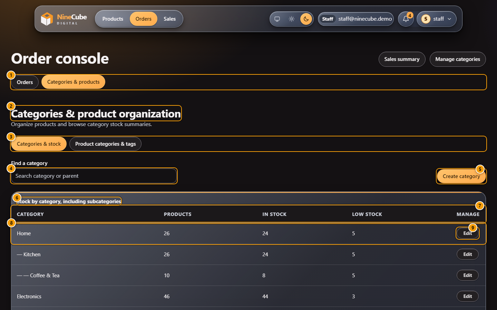

These four pictures are in the dark theme, which is how the request for this section arrived. The
theme is a header choice every screen honours, and the marks are drawn over the live controls with a
white ring, so they stay legible on either background.

1. The staff screen splits in two: the order console and this category manager. The half you are on
   carries the amber fill
2. The section heading
3. The two views: the tree with its stock summary, and the product category and tag editor
4. Find a category by its own name or its parent’s. It filters as you type and goes back to the first page
5. Create category opens the same form on an empty record
6. The summary counts every product in the branch, not only the ones filed directly under it
7. Category, Products, In stock, Low stock and Manage
8. One row per category, indented by how deep it sits. An inactive category carries its own badge
9. Edit opens the category form. Nothing on this screen changes a stock figure

Eight categories to a page. A product filed under two branches of the same tree is counted once, so a
parent’s figure is not the sum of its children’s — the same subtree rule the customer’s filter runs
on, and the one `Subtree_filters_deduplicate_multi_category_products_and_counts_match` measures.

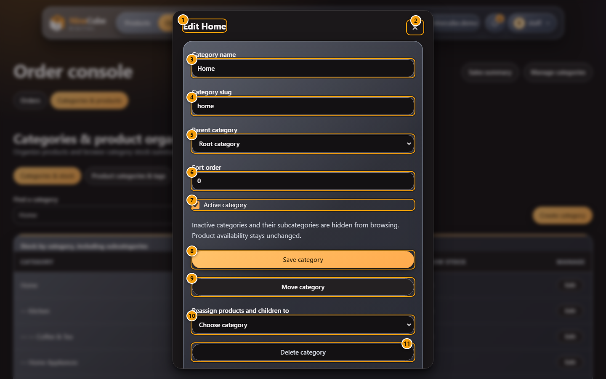

The whole lifecycle of one category, opened from a row’s Edit button or from Create:

1. The dialog is named after the category, so a screen reader and the address of the request agree
2. Close dialog. Escape does the same thing and hands focus back to the Edit button you came from
3. Category name, required, up to 120 characters
4. The slug used in the address bar, written for you from the name and still editable
5. Parent category. Choosing another branch is what moves this one
6. Sort order inside the parent
7. Active category. Switching it off hides the branch and everything under it from browsing, and leaves
   stock alone
8. Save category
9. Move category reparents on its own. A branch moved under one of its own descendants is refused:
   *A category cannot move under itself or a descendant.*
10. Reassign products and children to: where the contents go when the category is deleted
11. Delete category. Greyed out while the category still holds products or children, so nothing is
    orphaned

The rules belong to the server, not to the form. Two siblings under one parent cannot share a name, a
move into a descendant is refused, and deleting an occupied category is refused until a reassignment
target is chosen — after which the products and the children move in one transaction, and a failure
part-way rolls the whole thing back. `Uncategorized`, the fallback every product without a home is
filed under, cannot be renamed, reparented, switched off or deleted; only its place in the order is
editable. None of these operations can change a stock figure — the tests assert that, including
`Concurrent_assignments_keep_one_primary_and_never_update_stock`.

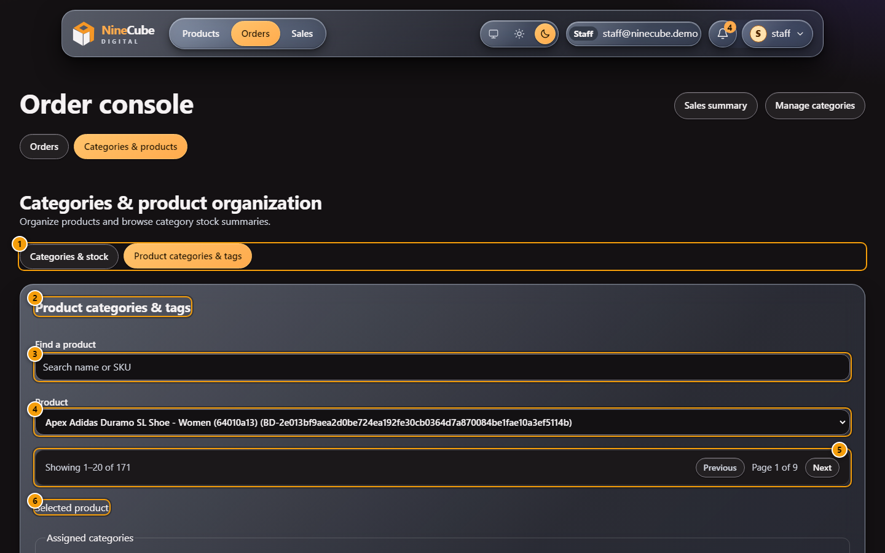

The second view files products. It reads the same paged product endpoint the catalogue filters on.

1. The two views, with this one selected
2. The heading of the view
3. Find a product by name or SKU. It waits a quarter of a second after you stop typing
4. The product, named with its SKU so two similar names cannot be confused
5. Twenty products to a page; the inventory list pages the same table at fifty
6. Once a product is chosen its own editor appears below, holding the categories it is filed under today

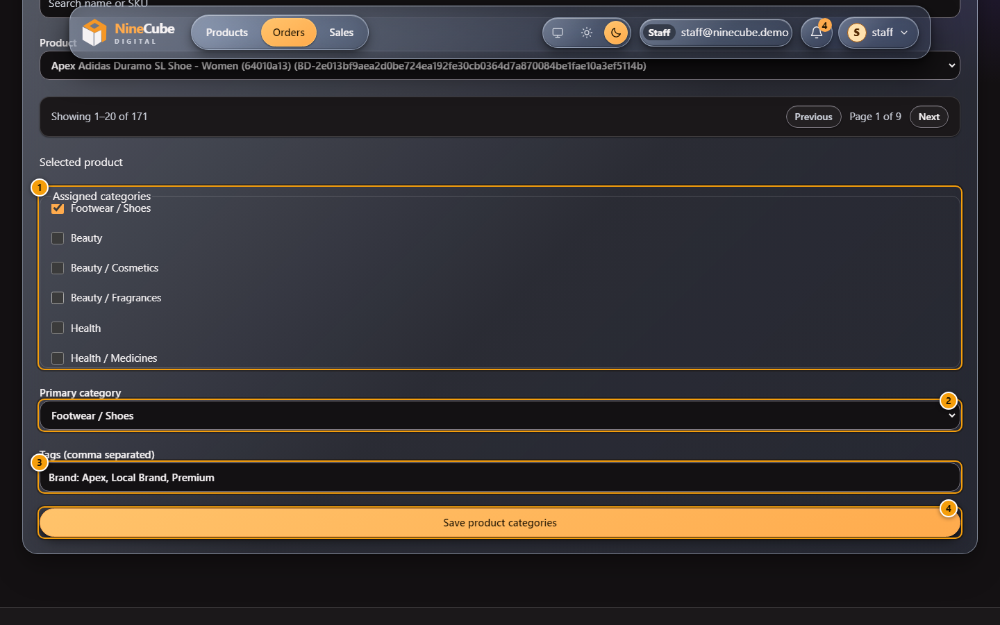

1. Every category in the tree, indented, with the ones this product is filed under ticked. The list
   scrolls inside its own box
2. Primary category: the one the product page marks *· primary* and the order line records. Always one
   of the ticked ones
3. Tags, comma separated. The customer’s filter chips are built from these
4. Save product categories sends the whole set as one request, so a product is never left between two
   states

Nothing is written until Save. The picture shows a running shoe filed under Footwear / Shoes, which is
also its primary category. Clearing every tick does not leave the product with no home: the server
files it under `Uncategorized` and makes that the primary, and the database refuses a second primary
however the request was built. This screen is the staff half of the same organization an inventory
manager can set in bulk (4.2); neither of them reaches stock.

---

## Part 4 — An inventory manager

### 4.1 Products and stock

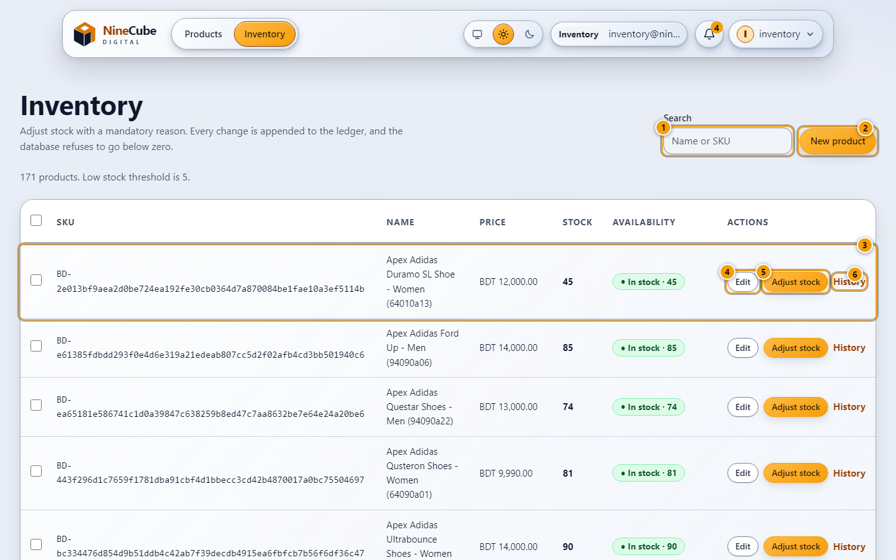

Where products are created and stock is corrected. Every change is appended to the ledger, and the
database refuses to go below zero.

1. Search by name or SKU
2. New product. A new product starts at zero stock on purpose — stock arrives through an adjustment so
   it is audited
3. Stock and availability per row. Rows at or below the low-stock threshold are marked
4. Edit opens the product form
5. Adjust stock opens the signed adjustment
6. History opens the same dialog on the movement ledger

The product form takes the name, price, category, brand, series and tags, and a gallery of images.
Uploads are checked before they touch disk: only real image formats are accepted, a truncated file or
an oversize payload is refused, and exactly one image is the primary one. Deleting the primary image
promotes the next in line.

### 4.2 Edit a page of products at once

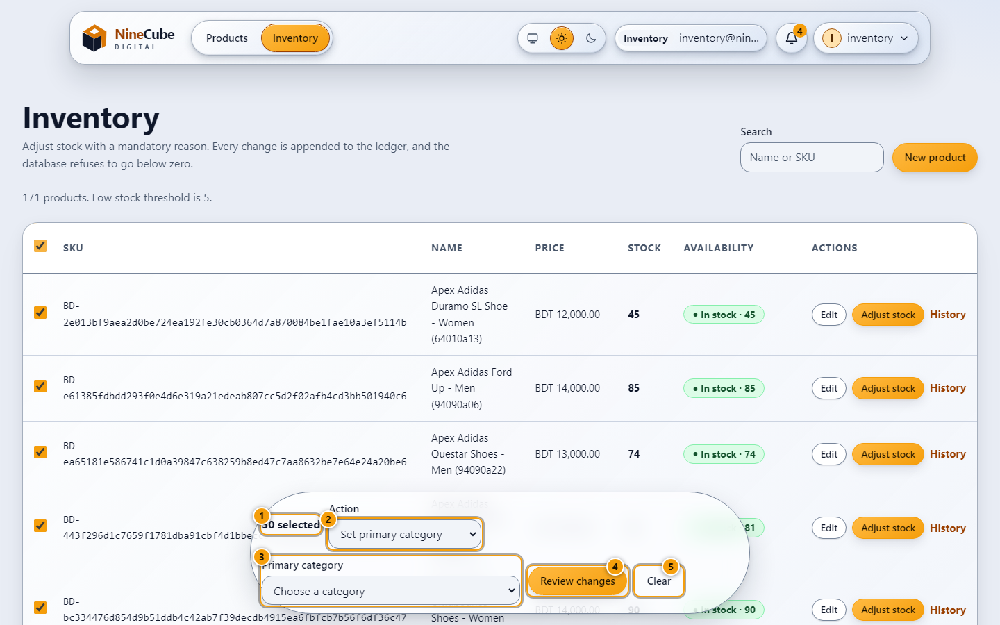

Category, tag, brand and active state can be set for a page of products at once. Stock is never part
of a bulk edit — it keeps its atomic, single-product path.

1. How many products are selected
2. The action. Stock is deliberately absent from this list
3. The parameter the action needs: a category, tags, or a brand and series
4. Review changes opens the confirmation dialog
5. Clear drops the selection and the bar goes with it

The six actions are Set primary category, Add tags, Remove tags, Activate, Deactivate, and Assign brand
and series. Choosing one changes the parameter field next to it; pressing Escape drops the selection.

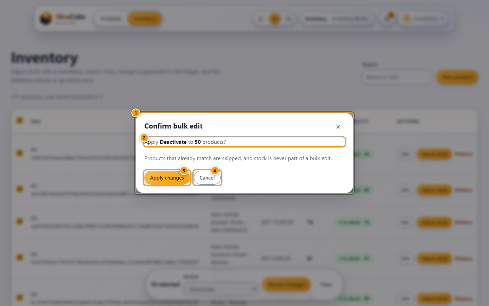

Nothing is written until this dialog is confirmed, and the summary says what will happen.

1. What is about to change, and to how many products
2. Products that already match are skipped, so re-running is safe
3. Apply changes sends one request for the whole selection
4. Cancel closes it without a request

The server applies the change to every listed product, keeps exactly one primary category per product,
and reports any product it refused — an unknown id, or one that would exceed the tag limit — as a
failure of that item only, so the rest of the batch still completes. More than two hundred ids in one
request are rejected before anything is written.

### 4.3 Adjust stock

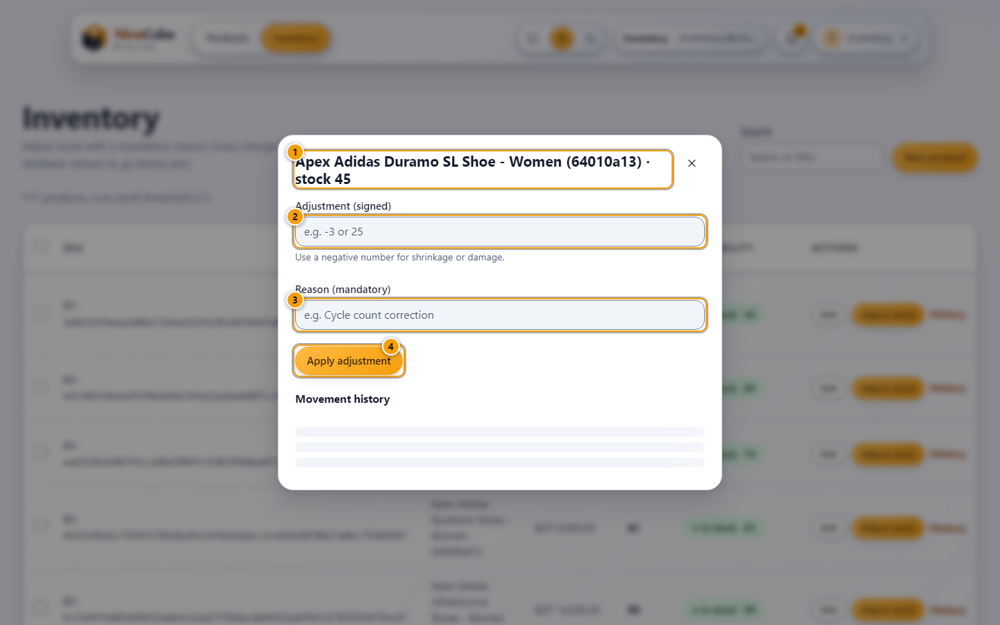

The only way stock changes outside an order, and it always carries a reason.

1. The product and its current quantity
2. A signed number: negative for shrinkage or damage, positive for a delivery
3. Reason is mandatory, and lands in the ledger with your name
4. Apply adjustment. If it would take the product below zero the server refuses it

An adjustment with no reason, or a delta of zero, is refused before it reaches the database. So is an
adjustment that would push a product below zero — the check is part of the same conditional update that
moves the quantity, which is why an adjustment and an order racing each other cannot silently overwrite
one another.

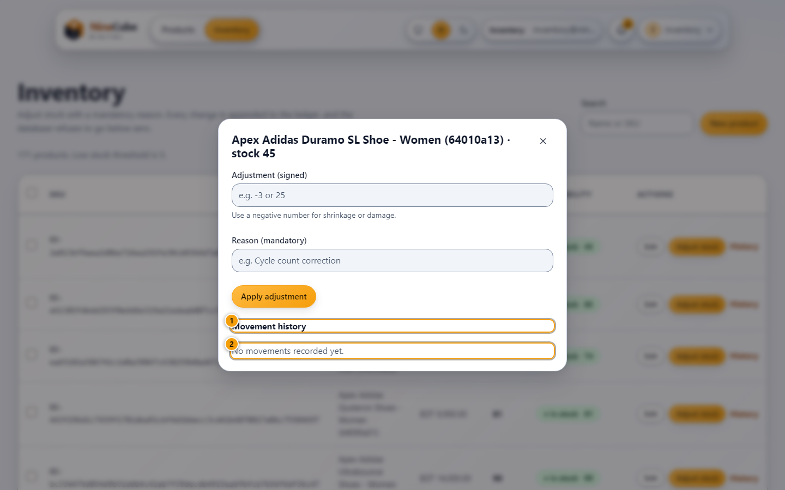

The same dialog, scrolled down: every stock change against the product, with who made it and why. A
product nobody has touched says so.

1. The ledger heading. Opening it from a row puts the keyboard focus here, so the history can be read
   straight away
2. Movement history for this product: when, by how much, why and who. A product with no movements yet
   says so

---

## Part 5 — An administrator

### 5.1 Accounts and roles

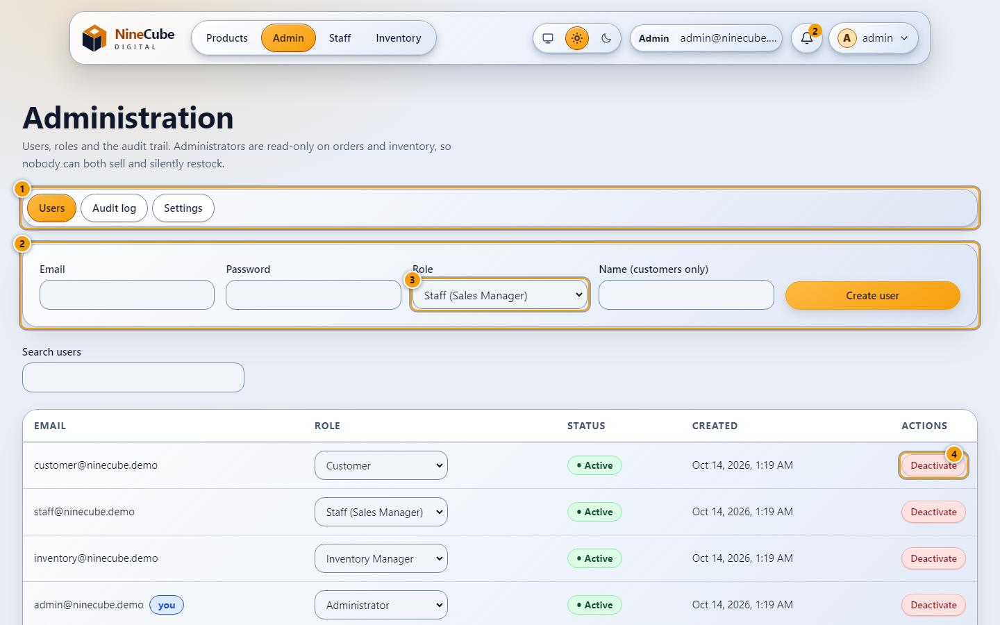

Administrators create staff logins, change roles and switch accounts off. They are read-only on orders
and inventory, so nobody can both sell and silently restock.

1. The three sections: Users, Audit log, Settings
2. Create a user: email, password, role, and a name when the role is Customer
3. Change a role from the row itself. It takes effect on the user's next request
4. Deactivate keeps the history and blocks the login. The last active administrator cannot be removed

A role change is picked up by tokens that were already issued, so an account demoted while its session
is live does not keep its old privileges. Deactivating an account stops it signing in and stops the
token it already holds, and the person's orders and audit entries remain intact.

### 5.2 Audit log and settings

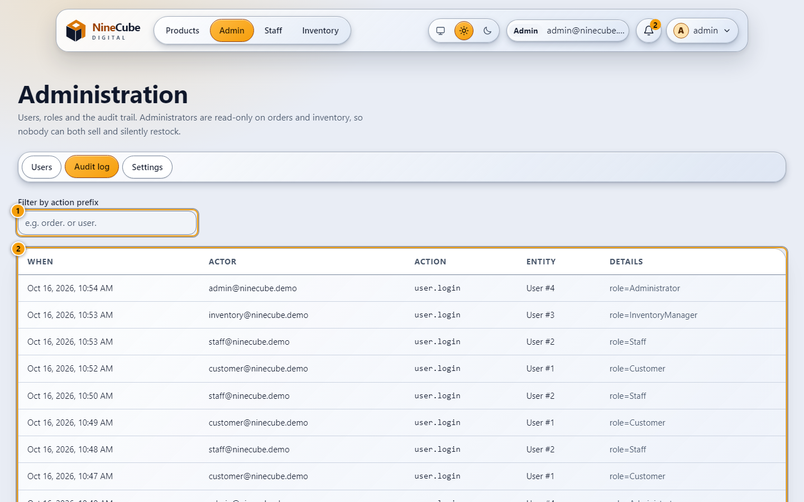

What happened, who did it and when. It is the record the concurrency design writes as it goes.

1. Filter by action prefix, for example `order.` or `user.`
2. When, actor, action, entity and the details of the change

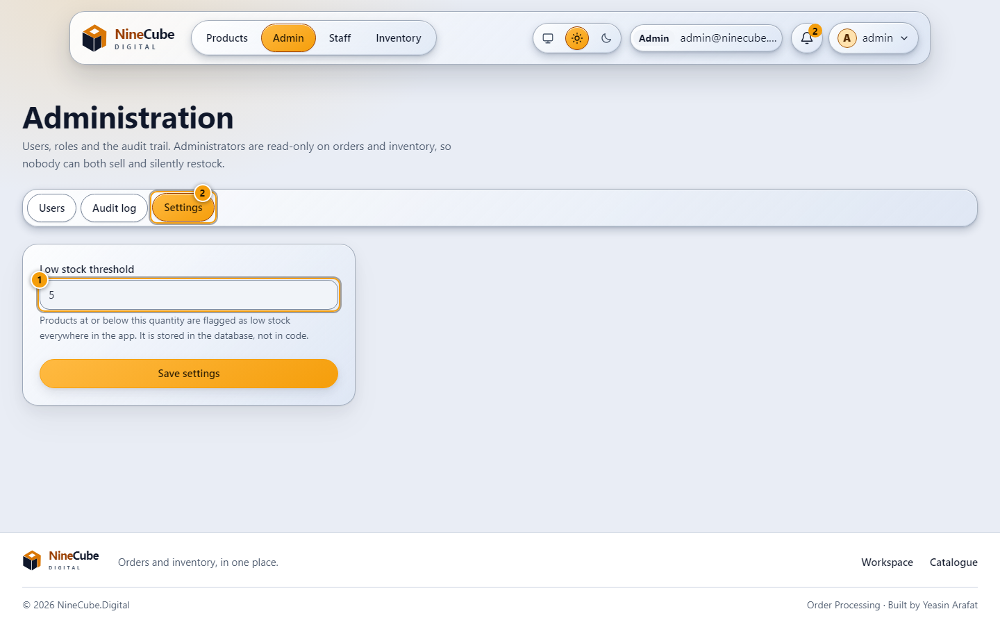

The one business number an administrator can edit.

1. Low stock threshold. Products at or below it are flagged everywhere in the app, and the inventory
   rows are marked
2. Save settings writes it to the database, not to a config file

---

## Part 6 — Appearance, notifications and accessibility

### 6.1 Theme

System follows your device; Light and Dark are stored and come back on the next visit. The choice is
made in the header and is available signed out as well as signed in. Translucent surfaces — the
navigation tray, the account menu, the filter drawer — are composited over the page behind them, so
the pairings were measured rather than assumed: in the light theme the selected amber reads
`rgb(181, 125, 30)` against a tray of `rgb(245, 248, 252)`, and in the dark theme `rgb(184, 133, 65)`
against `rgb(118, 123, 137)`. Both clear 4.5:1 for the text drawn on them (5.27:1 and 5.72:1).

### 6.2 The selected tab

The tab you are on carries the amber fill, the same treatment the open account menu and the switched-on
theme option take. It is the header's single "this one" signal; there is no separate moving highlight
layer underneath it, which is what made the older screenshots disagree with the CSS.

### 6.3 Screen — notifications

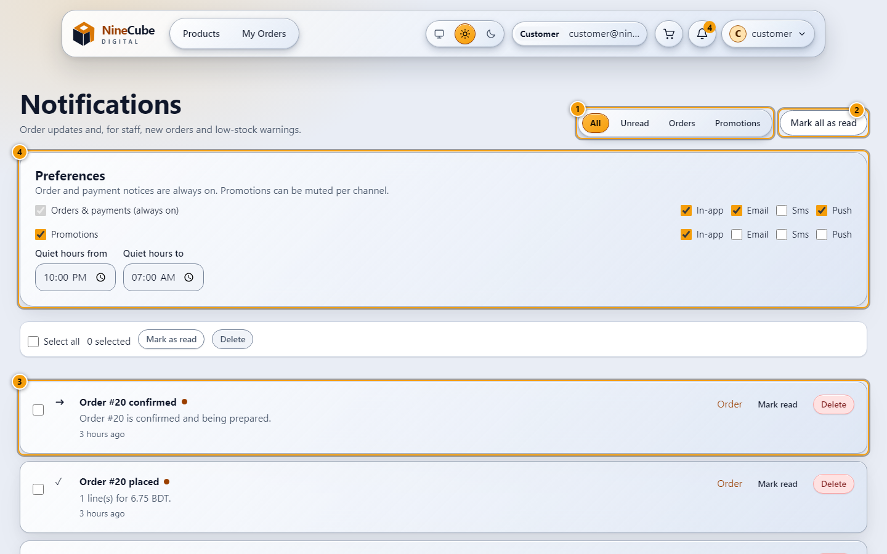

Order updates for everyone, plus new-order and low-stock messages for staff.

1. Filter the inbox: All, Unread, Orders, Promotions
2. Mark all as read
3. The inbox: what changed, when, and a link to the order it is about. Ticking rows makes Mark as read
   and Delete apply to the selection
4. Preferences. Order notices are always on; promotions can be muted per channel, with quiet hours

The bell in the header shows a capped number so it cannot stretch the layout, while the accessible
label keeps the exact count. Marking the selection read is one request; the unread figure and the
Unread filter are read from the same field, so they cannot disagree. Order notices are grouped when the
same order moves twice, and anything needing attention is listed above the routine updates. An inbox
with nothing in it says so in words rather than showing an empty frame, and so does a filter that
matches nothing.

A customer never sees another customer's notification. Reading, marking or deleting one that is not
yours answers `404`, the same as one that does not exist, so the inbox cannot be used to probe.

The preferences panel is stored in the browser you are using, not on the server. That is deliberate: the
system has no email or SMS delivery yet, so a channel toggle can only ever govern what the app shows you,
and pretending otherwise would put a setting in the database that nothing reads.

### 6.4 Keyboard and screen-reader behaviour

- Navigation is a real tab list: arrow keys, Home and End move between links, Escape closes a menu,
  clicking outside closes it, and the menu is portalled so the header cannot clip it.
- Dialogs take focus when they open, keep it inside themselves with Tab and Shift+Tab, and return it
  to the control that opened them. Escape closes them.
- Stock state is never carried by colour alone: every badge has a glyph and a word.
- The quantity stepper announces its value through a live region, and the +/- buttons are real buttons,
  so it works with a mouse, a keyboard, or a screen reader.
- Where a page has to be scrolled while a dialog is open, the dialog's own scroll area is used rather
  than the page behind it.
- Reduced motion is honoured: the showcase falls back to a static grid, table rows stop animating, and
  the card lift is taken off.

---

## Part 7 — How each screen is proven

Every claim above is backed by a test that runs against the same behaviour. The unit and component
tests use a real browser-shaped DOM with the API mocked at the HTTP boundary; the end-to-end tests use
Chromium against the running API and database; the backend tests exercise the API with SQL Server.

**Running them**

```bash
cd web && npm run test:run                            # 23 files, 162 tests
cd web && npx playwright test                         # needs API + SPA + seeded data (about 50 min)
cd src/NineCube.Tests && dotnet test                  # 108 tests
```

**Signing in and the two entry screens** — `web/src/test/guards.test.tsx`, `web/e2e/public-home.spec.ts`,
`web/e2e/showcase.spec.ts`, `web/e2e/appearance.spec.ts`

- `shows the public showcase to an anonymous visitor without demanding a sign-in`
- `sends an anonymous visitor to the login page`, `redirects a customer away from the admin console and inventory`
- `falls back to a static nine-card grid when WebGL is unavailable`
- `falls back when the visitor asks for reduced motion`
- `${role} login and home visits stay inside the workspace`

**The catalogue: filters, URL state, badges** — `web/src/test/catalogue-sidebar.test.tsx`,
`catalogue-filters.test.tsx`, `categories.test.tsx`, `stock-badge.test.tsx`, `product-card.test.tsx`,
`catalog.test.ts`, `web/e2e/sidebar-layout.spec.ts`, `catalogue-images.spec.ts`

- `restores URL filters after remount and respects back and forward navigation`
- `selects a brand, shows only its series, and writes both to the URL`
- `counts a cross-listed product once in a parent with the other filters applied`
- `follows "In-stock only" everywhere and starts unchecked`
- `marks the selected row with a tick and words, not colour alone`
- `never relies on colour alone - every state carries a glyph and a text label`
- `cannot be increased past the available stock`, `is keyboard operable`, `exposes the quantity through an aria-live region so changes are announced`
- `a deep link restores the selection, the chips and the result count`

**Cart and checkout** — `web/src/test/checkout.test.tsx`, `catalogue-roles.test.tsx`, `web/e2e/order-flow.spec.ts`

- `places an order, shows the confirmation and clears the cart`
- `renders the short items on 409 and keeps the cart`
- `does not send a second request when the button is double clicked`
- `keeps the same idempotency key when retrying after a server error`, `shows an inline message on a 400 without retrying the same idempotency key`
- `redirects to the login page when the API answers 401`
- `a customer reserves stock and a staff member confirms the order` (end to end, against the real database)

On the server side the same promises are checked without a browser
(`src/NineCube.Tests/OrderPlacementTests.cs`):

- `Test01_Valid_order_returns_201_decrements_stock_and_computes_the_total`
- `Test02_Quantity_above_stock_returns_409_leaves_stock_untouched_and_saves_no_order`
- `Test04_Multi_item_order_with_one_unavailable_item_rolls_back_every_line`
- `Test06_Repeating_the_idempotency_key_returns_the_same_order_and_reserves_stock_once`
- `Test06b_Different_customers_may_reuse_the_same_idempotency_key`
- `Test07_Race_for_the_last_unit_produces_exactly_one_success_and_one_conflict`
- `Test08_Fifty_parallel_orders_for_ten_units_yield_exactly_ten_successes`

**Orders, statuses, cancellation and the invoice** — `web/src/test/orders.test.tsx`,
`modern-customer.test.tsx`, `web/e2e/order-appearance.spec.ts`

- `renders the lines, the timeline and the invoice link`, `renders the printable invoice`
- `offers cancel while the order is pending`, `hides the cancel button once the order has shipped`
- `shows an error state for an order the customer cannot see (404)`
- `keeps shipped separate from delivered and status counts sum to the order total`

`src/NineCube.Tests/OrderCancellationTests.cs` and `OrderStatusTransitionTests.cs`:

- `Test09_Cancel_restores_stock_and_releases_the_reservation`, `Test09_Cancelling_twice_restores_stock_only_once`
- `Test09_Cancelling_concurrently_restores_stock_only_once`
- `Test11_Pending_cannot_be_shipped_without_confirmation`, `Test11_Reject_restores_stock_and_rejected_orders_are_terminal`
- `Test11_Racing_confirm_and_reject_produces_exactly_one_winner`

**Dashboard, profile, addresses** — `web/src/test/account.test.tsx`,
`src/NineCube.Tests/ProfileAndDashboardTests.cs`

- `summarises orders and spending in BDT with a route to each order`, `shows an empty state instead of a page of zeros`
- `changes the password only when the current one is right`
- `creates and removes a saved address`, `refuses an incomplete address before it leaves the browser`
- `Addresses_are_created_edited_and_deleted_with_exactly_one_default`
- `Another_customers_address_id_is_a_404_not_a_403`, `Dashboard_totals_match_the_orders_table_including_the_cancellation`

**Notifications** — `web/src/test/account.test.tsx`, `sticky-notifications.test.tsx`,
`src/NineCube.Tests/NotificationTests.cs`

- `shows the unread count as a number and empties the badge after marking all read`
- `marks the selected rows read in one action and clears the selection`, `deletes one notification`
- `filters to unread and says so when nothing is left`
- `groups repeated events for the same order`, `sorts order/payment issues before delivery updates`, `caps the stack at 3 in the provider source`
- `Placing_an_order_notifies_the_customer_and_every_staff_account`, `A_rejected_order_writes_no_notification_at_all`
- `Low_stock_reaches_staff_once_and_is_not_duplicated`, `Another_users_notification_is_a_404_for_reading_marking_and_deleting`
- `keeps every stacked surface on the shared layer scale` — the tray, the navbar and the toast column
  are all read off the same `--z-*` scale, so a toast can never be trapped under an open tray

**The staff console and bulk order actions** — `web/src/test/staff-order-bulk.test.tsx`,
`web/e2e/staff-order-bulk.spec.ts`, `admin-order-permissions.spec.ts`

- `classifies processing queues and keeps invoices consistent across all states`
- `reviews selected orders, prevents duplicate submission and reports partial failures`
- `never sends updates when the review is cancelled`
- `keeps administrator order access read-only without posting forbidden mutations`
- `${width}px: review and partial conflicts`

**Sales reporting** — `web/src/test/sales-charts.test.tsx`, `helpers.test.ts`, `web/e2e/sales-analytics.spec.ts`,
`surface-depth.spec.ts`

- `charts actual order counts while retaining zero revenue for cancelled/rejected orders`
- `shows honest empty states without invalid or invented chart values`
- `labels revenue with the selected report currency`, `defaults the range to the last 30 days ending today`
- `${width}px ${theme}: real report charts and filters`

**The category manager and the product organization** — `web/src/test/categories.test.tsx`,
`web/e2e/staff-organization.spec.ts`, `web/e2e/categories.spec.ts`,
`src/NineCube.Tests/CategoryTests.cs`

- `saves multiple categories, a primary selection, and tags without stock fields`
- `shows a cycle error inline and requires reassignment for an occupied category`
- `${width}px ${theme}: category dialog and compact views` — the dialog is opened, measured and escaped
  at 390 and 1440 px in both themes, and the page is checked for horizontal overflow
- `staff category editor shows cycle conflicts and protects stock`, `staff can create, rename, move, deactivate and delete a category`
- `Subtree_filters_deduplicate_multi_category_products_and_counts_match` — the figures in the summary table
- `Cycles_depth_and_duplicate_sibling_names_are_rejected`, `Rename_and_move_recompute_the_subtree_without_changing_stock`
- `Delete_requires_reassignment_and_reparents_children_atomically`, `Failed_reassignment_rolls_back_products_children_and_paths`
- `Uncategorized_stays_active_at_the_root_under_its_original_name`
- `Empty_assignment_falls_back_and_the_database_rejects_a_second_primary`, `Inactive_parent_hides_subtree_but_ordering_and_snapshots_still_work`

**Products, bulk edits, images and the stock ledger** — `web/src/test/inventory-bulk.test.tsx`,
`categories.test.tsx`, `web/e2e/actionable-surfaces.spec.ts`, `categories.spec.ts`, and
`src/NineCube.Tests/BulkProductUpdateTests.cs`, `StockAdjustmentTests.cs`, `ProductImageUploadTests.cs`,
`CategoryTests.cs`, `BrandCatalogTests.cs`

- `leaves stock out of the action list`
- `selects the whole page and sends one request with the chosen category`
- `refuses to send an action whose parameter is missing`, `reports the products the server refused without failing the batch`
- `History opens the same dialog on the ledger, not on the empty form`
- `Bulk_edits_never_touch_stock_even_when_an_order_is_the_reason`
- `More_than_200_ids_is_rejected_before_anything_is_written`, `An_unknown_id_fails_on_its_own_while_the_rest_of_the_batch_completes`
- `Test12_Adjustment_writes_a_ledger_row_with_user_and_reason`, `Test12_Negative_adjustment_cannot_push_stock_below_zero`
- `Test12_Concurrent_orders_cannot_be_overwritten_by_an_adjustment`, `Test12_Inactive_products_cannot_be_ordered`
- `Non_images_truncated_files_and_oversize_payloads_are_rejected_before_they_touch_disk`
- `Delete_requires_reassignment_and_reparents_children_atomically`, `Concurrent_assignments_keep_one_primary_and_never_update_stock`
- `Backfill_derives_brands_from_tags_and_series_from_names_without_inventing_models`

**Administration** — `web/src/test/guards.test.tsx`, `account.test.tsx`, `src/NineCube.Tests/AuthorizationTests.cs`

- `keeps a staff sign-in from editing a customer record it does not have`
- `Test10_Customer_is_forbidden_from_staff_inventory_and_admin_endpoints`
- `Test10_Staff_cannot_touch_stock_or_products`, `Test10_Inventory_manager_cannot_change_order_status`
- `Test10_Administrator_role_change_takes_effect_on_existing_tokens`
- `Test10_Deactivated_user_cannot_log_in_and_loses_access`, `Test10_Administrator_cannot_remove_the_last_administrator`

**Look, contrast and the surfaces themselves** — these are the tests that hold the visual contract in
Part 6, and they measure rendered pixels rather than reading the stylesheet:
`web/src/test/light-theme.test.tsx`, `actionable-surfaces.test.ts`, `surface-depth.test.ts`, `navbar.test.tsx`,
`web/e2e/navbar-matched.spec.ts`, `actionable-surfaces.spec.ts`, `light-theme-surfaces.spec.ts`,
`catalogue-glass.spec.ts`, `theme-images.spec.ts`, `ui-audit.spec.ts`

- `meets 4.5:1 for text, muted text, chips, badges, buttons and brand`
- `formats the store currency as BDT by default`
- `keeps selection, borders and focus visibly distinct from the card surface`
- `marks the current navbar tab with the same selected amber as the other switched-on controls`
- `${theme}: the current tab is selected in the same amber as the open account menu`
- `a card chip is painted as the filter it applies, and applies it`
- `every row action reads as a control on its own table`
- `rows fade in with motion allowed and stand still without it`
- `@${viewport.width}px` — the ui audit signs in as each role at 390, 768 and 1440 px and fails on a
  console error, a broken request, or horizontal overflow

---

## Appendix — regenerating these screens

```bash
cd web && set -a && . ../.env && set +a && node scripts/capture-manual.mjs
```

It needs the API on `:5080`, the SPA on `:5173`, and the demo accounts seeded. It signs in as each
role in turn, visits the real route, waits for the real data, draws the numbered marks over the
measured bounding boxes of the controls, and writes 28 PNGs plus `docs/manual/callouts.json` into
`docs/manual/`. Twenty-four of them are in the light theme; the four around the category manager (3.3)
are in the dark one, which is the only way to show that the treatment holds in both. A callout whose
control is not on screen is reported rather than silently dropped, so the pictures cannot drift away
from the wording in this manual without somebody noticing.

This file is the source. `python tools/build_manual_docx.py` lays the same text out as `NineCube-User-Manual.docx` for print: a cover with the brand artwork, a contents list, one page break per part, and the 28 screens as numbered figures carrying the captions written here. Nothing is retyped between the two, so they cannot say different things.
